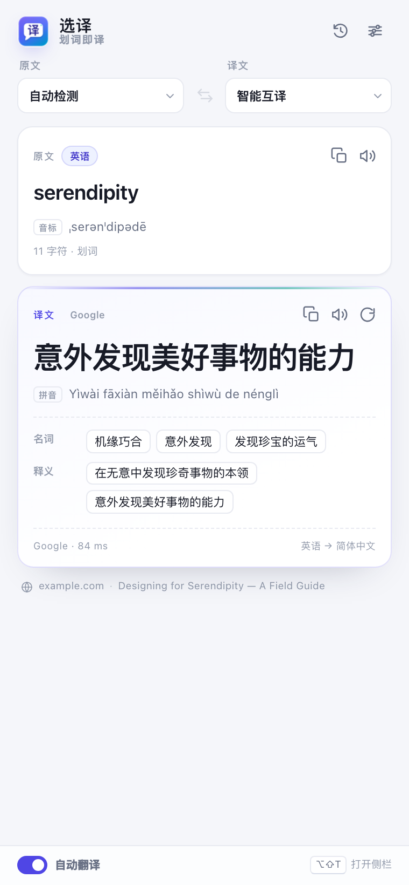
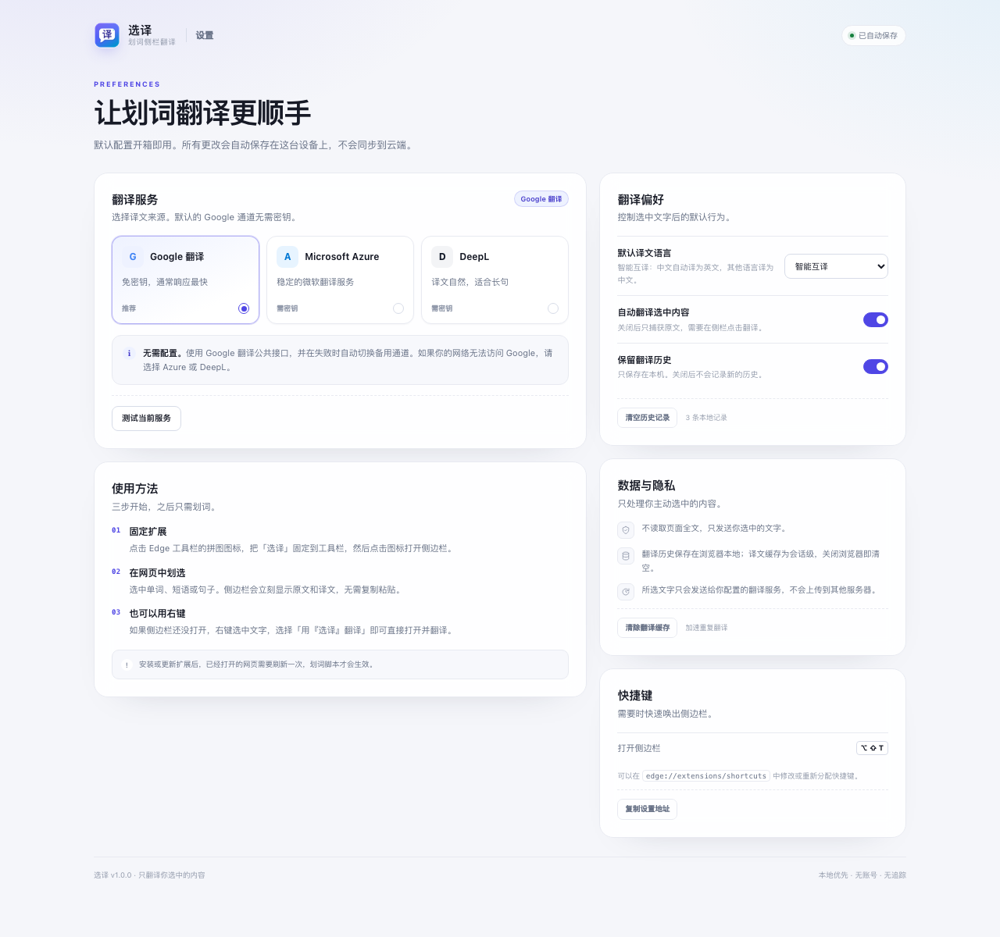

# 选译 · 划词侧栏翻译

一个同时支持 Edge 与 Safari 的轻量划词翻译扩展：**在网页上选中单词或句子，即刻查看译文**。Edge 使用原生侧边栏；Safari 因平台限制使用浮动翻译窗口。无需登录，默认免密钥即可使用。

> **Edge 116+** · **Safari 26+（临时加载）** · Manifest V3 · v1.0.0

## 功能

- **划词即译**：选中文字后立即显示原文，译文通常在一两百毫秒内返回，不打断浏览。
- **原生侧边栏 / 浮动窗口**：Edge 使用原生侧边栏；Safari 使用常驻浮动翻译窗口。
- **原文也保留**：同时呈现原文、译文、音标/拼音与词典释义，方便对照。
- **右键直接翻译**：侧栏未打开时，右键选中文字 →「用『选译』翻译」即可打开并翻译。
- **双语智能互译**：中文自动译为英文，其他语言自动译为中文；也可手动指定语言。
- **快速通道**：本地会话缓存 + 自动备用通道 + 缓存命中时瞬间返回。
- **隐私优先**：不读取整页内容，只发送你主动选中的文字；历史只存在本机。
- **深色模式**：跟随系统自动切换。

## 界面预览

<p align="center">
  
</p>
<p align="center"><sub>侧边栏 · 译文与词典（示例数据）</sub></p>

<p align="center">
  
</p>
<p align="center"><sub>设置页 · 翻译服务与偏好</sub></p>

<p align="center"><sub>Safari 版会复用同一套界面，但以约 420px 宽的浮动窗口显示。</sub></p>

## 安装

1. 把整个 `edge-plug` 文件夹放到一个固定位置（不要删除）。
2. 在 Edge 地址栏打开 `edge://extensions`。
3. 打开左下角的 **开发人员模式**。
4. 点击 **加载解压缩的扩展**，选择包含 `manifest.json` 的这个文件夹。
5. 点击 Edge 工具栏的拼图图标，把 **选译** 固定到工具栏。
6. 点击「选译」图标，打开侧边栏。

> 安装或重新加载扩展后，**已经打开的网页需要刷新一次**，划词脚本才会生效。


## Safari 版

Safari 没有 Chrome 的 `sidePanel` API，因此无法提供原生停靠侧栏。Safari 版使用一个约 **420px 宽的常驻浮动翻译窗口**，划词、翻译、缓存、历史和设置逻辑与 Edge 版一致。

`safari/` 是已经构建好的 Safari 临时加载版（Safari 26+，无需 Xcode）：

1. 打开 Safari → 设置 → 高级，勾选「显示网页开发者功能」。
2. 切换到「开发者」标签页，点击 **「添加临时扩展…」**。
3. 选择 `safari/` 文件夹（不是项目根目录），输入 Mac 密码授权。
4. 在 Safari 设置 → 扩展中启用「选译」，并允许访问网页。
5. 点击 Safari 工具栏的「选译」图标打开浮动窗口；刷新已打开的网页后即可划词。

> **临时加载扩展在退出 Safari 后会失效**，下次启动需要重新添加。长期使用需要 Xcode 签名，或通过 App Store 分发；当前构建面向开发和本地验证。
>
> 更详细的步骤和限制见 [safari/README.md](safari/README.md)。

Safari 构建由下面的命令生成（无第三方依赖）：

```bash
node scripts/build-safari.mjs
```

如果之后修改了 `src/`，需要重新运行该命令，再在 Safari 中重新添加 `safari/` 文件夹。

## 使用

1. 先点击工具栏图标打开翻译面板（Edge 为原生侧栏，Safari 为浮动窗口）。
2. 在任意网页中划选一个单词、短语或句子。
3. 译文会自动出现在侧边栏；原文、语言、音标和释义也会同步更新。
4. 如果侧边栏没开，直接右键选中文字 →「用『选译』翻译」。

翻译面板里的操作（Safari 中把「侧栏」理解为浮动窗口）：

| 操作 | 说明 |
| --- | --- |
| 语言下拉框 | 手动指定原文/译文语言；译文语言会被记住 |
| 交换按钮 | 拿到译文后，把译文语言作为新的原文语言反向翻译 |
| 喇叭图标 | 朗读原文或译文 |
| 复制图标 | 复制原文或译文 |
| 刷新图标 | 重新请求翻译 |
| 底部「自动翻译」 | 关闭后，划词只显示原文，点击按钮才请求网络 |
| 历史图标 | 查看、恢复或删除最近 30 条翻译（可关） |
| 设置图标 | 配置翻译服务、默认语言、隐私选项 |

### 快捷键

默认快捷键是 `Alt + Shift + T`（macOS 上为 `⌥ ⇧ T`），用于打开侧边栏。

如果和系统或别的扩展冲突，可在 `edge://extensions/shortcuts` 中修改。Safari 版快捷键可在 Safari 设置的扩展页面中调整。

## 翻译服务

默认使用 **Google 翻译公共接口**，不需要填写密钥。该接口并非 Google 官方为扩展提供的长期 API，可能因网络、频率限制或接口调整而暂时不可用；扩展会自动尝试备用通道。

在设置页可以切换：

| 服务 | 密钥 | 适用场景 |
| --- | --- | --- |
| Google 翻译 | 不需要 | 开箱即用，速度优先 |
| Microsoft Azure Translator | 需要订阅密钥，可选区域 | 无法访问 Google 网络时的稳定选择 |
| DeepL | 需要 API 密钥（免费版以 `:fx` 结尾） | 更自然的长句译文 |

设置页提供 **测试当前服务** 按钮，会实际请求一句示例并显示耗时。Azure/DeepL 的密钥只保存在本机扩展存储中。

## 速度是怎么做到的

- **短延迟捕获**：鼠标松开后 60ms 内读取选区，避免拖拽时频繁请求。
- **立即出原文**：后台先把选中文字推给侧栏，请求结果到达后再替换译文，没有“空白等待”。
- **轻量请求**：长句不请求词典/音标字段；只有单词和短语才返回更丰富的数据。
- **本地会话缓存**：相同文本 + 语言 + 服务直接命中内存缓存，显示「即刻」。
- **自动备用通道**：Google 主接口失败时快速降级到备用接口。
- **请求竞态处理**：新的划词会中止旧请求，过期结果不会覆盖新内容。
- **无 token、无构建层**：原生 MV3 + 原生 DOM，安装即用。

实测本机 Google 通道多数请求约 **50–300ms** 返回，首次请求或网络波动时偶尔会更久；缓存命中时基本为 0 网络耗时。

## 隐私

- 内容脚本只捕获你当前选中的文字，不读取页面全文。
- 选中文字只会发送给你在设置中选择的翻译服务。
- 翻译历史保存在 `chrome.storage.local`，可随时清空；不开启历史时不会写入。
- 译文缓存保存在 `chrome.storage.session`，关闭浏览器即清空。
- 没有账号、没有分析统计、没有远程配置。

## 已知限制

- Edge 版需要 **Edge / Chromium 116 或更高版本**（`sidePanel` 和 `sidePanel.open` API）。
- Safari 版需要 **Safari 26+**；Safari 没有原生侧栏 API，且临时加载会在退出 Safari 后失效。
- 不支持 `edge://`、`chrome://`、扩展商店等受保护页面。
- PDF 阅读器、部分浏览器内置页面无法注入内容脚本。
- 如果网页位于跨域 iframe 中，划词仍可工作，但页面信息可能显示为 iframe 的 URL。
- `file://` 本地页面需要在 `edge://extensions` 的扩展详情里开启「允许访问文件网址」。
- Edge 版如果系统禁用了侧边栏 API，点击图标将无法打开；可先升级 Edge 后重试。Safari 版不受此影响，会使用浮动窗口。
- Google 公共接口不适合大规模商业调用；有正式需求请配置 Azure 或 DeepL。

## 目录结构

```text
manifest.json              MV3 清单
src/
  background.js            Service Worker：翻译调度、缓存、右键菜单、侧栏/浮动窗口打开
  browser-compat.js        Safari 的 browser/chrome 命名空间兼容层
  content.js               划词捕获（无页面 UI、无全文读取）
  sidepanel.html/.css/.js  侧边栏界面
  options.html/.css/.js    设置页
  lib/
    providers.js           Google / Azure / DeepL 适配与解析
    languages.js           语言代码、智能目标语言、服务商映射
    settings.js            设置结构与本地持久化
    cache.js               会话级 LRU 翻译缓存
    platform.js            宿主形态检测（原生侧栏 / 浮动窗口）
icons/                     扩展图标
docs/                      界面预览图
safari/                    Safari 临时加载构建（由脚本生成）
scripts/build-safari.mjs   Safari 构建脚本
```

无 npm 依赖。Edge 版无构建步骤；修改源码后，在 `edge://extensions` 点击扩展的刷新按钮并刷新测试网页。Safari 版修改 `src/` 后运行 `node scripts/build-safari.mjs`，重新在 Safari 中添加临时扩展。

## 免责声明

本项目与 Google、Microsoft、DeepL 无关联。公共翻译接口的可用性、速率和条款由对应服务提供方决定，请按需选择并遵守其使用条款。
